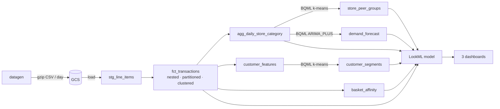

# Basketpulse - Retail Analytics Platform

[](../../actions/workflows/ci.yml)


**Retail analytics on BigQuery and Looker: basket-level facts, in-warehouse ML, and three LookML dashboards for executives, store managers and merchandisers, with a synthetic data generator that scales from a laptop to 50 M transactions.**

BasketPulse answers the questions retail teams ask every week:

- *How is the group doing, and which stores and categories are driving it?* (YoY, regional and store movers)
- *Is this store under-performing, or just in a tough peer group?* (like-for-like peer comparison, 28-day demand outlook)
- *Which products should we bundle, and which are dragging baskets down?* (lift and confidence weighted by **basket margin**)
- *Who are our customers, and who is slipping away?* (ML segments, at-risk detection)

---

## Features

| Area | What you get |
|---|---|
| **Executive Overview** | Net sales, transactions, basket value and margin KPIs with automatic prior-year comparison; regional table; top and bottom 10 stores by YoY; category mix; customer-segment value |
| **Store Performance** | One store vs. its ML-derived peer group (sales per sq ft percentile), category mix, segment mix, hourly traffic, 28-day demand forecast with 90% interval |
| **Basket Affinity** | Pairwise support / confidence / lift, bundle candidates (lift >= 2 and basket margin >= $15), lift-vs-margin scatter, category-to-category affinity matrix |
| **Customer segmentation** | BQML k-means (k=4) on recency, frequency, monetary, basket value, margin rate, category breadth; segments named by behaviour, not centroid id |
| **Store peer groups** | BQML k-means (k=5) on size, throughput, basket value, margin and fresh share |
| **Demand forecasting** | One `ARIMA_PLUS` model, one series per store x category (up to 400 x 12 = 4,800 series at XL), holiday-aware |
| **Data generator** | Seeded, deterministic, vectorised NumPy generator with shopping missions, seasonality, churn and promotions |
| **Performance tooling** | A/B benchmark harness for table layouts and an analytical partition-pruning estimator |

## Architecture



Highlights (full rationale in [docs/ARCHITECTURE.md](docs/ARCHITECTURE.md)):

- **Nested basket table**: one row per transaction with an `ARRAY<STRUCT>` of lines plus pre-computed basket rollups. Basket-level queries never UNNEST; line-level queries do, through a dedicated LookML view.
- **Partition by day, cluster by `store_id, customer_id, channel_id`**, matching the filters every tile uses.
- **YoY without losing partition pruning**: the explore widens the partition predicate to cover the prior-year window automatically.
- **Apriori-style pruning** keeps market-basket pair counting tractable at XL.
- **Datagroups** tie dashboard cache invalidation to the latest loaded date.

## Tech stack

| Layer | Technology |
|---|---|
| Warehouse | Google BigQuery (partitioning, clustering, nested and repeated fields) |
| ML | BigQuery ML: `KMEANS`, `ARIMA_PLUS` |
| BI / semantic layer | Looker (LookML models, explores, datagroups, LookML dashboards) |
| Data generation and tooling | Python 3.12, NumPy, pandas |
| Storage / loading | Cloud Storage, BigQuery load jobs (`google-cloud-bigquery`, `google-cloud-storage`) |
| CI | GitHub Actions, pytest, custom LookML static checks |

## Repository layout

```
basketpulse/
├── manifest.lkml                  # constants (project, dataset, connection, currency)
├── basketpulse.model.lkml         # model, value formats, datagroups
├── views/                         # 10 LookML views (incl. nested line-items view)
├── explores/                      # transactions, store x category cube, basket affinity, demand forecast
├── dashboards/                    # executive_overview, store_performance, basket_affinity
├── sql/
│   ├── 01_schema.sql              # one-time DDL (setup)
│   ├── 02_fct_transactions.sql    # nested, partitioned, clustered fact
│   ├── marts/                     # daily cube, customer features, basket affinity
│   └── bqml/                      # customer segments, store peer groups, demand forecast
├── datagen/                       # synthetic data generator (catalog + generate)
├── scripts/                       # run_sql.py, load_data.py, lint_lookml.py
├── benchmarks/                    # bench.py (BigQuery A/B), estimate.py, queries/
├── tests/                         # generator, SQL pipeline, LookML lint, benchmark helpers
└── docs/                          # ARCHITECTURE, DEPLOYMENT, DATA_DICTIONARY, BENCHMARKS
```

## Quick start

```bash
pip install -r requirements-gcp.txt -r requirements-dev.txt
make test lint                                   # no cloud access needed
make data-dev                                    # 1 M transactions -> data/dev (about 25 s on 1 core)

export PROJECT=my-gcp-project BUCKET=my-bucket
make setup PROJECT=$PROJECT                      # ONE-TIME: dataset + empty tables
make load  PROJECT=$PROJECT BUCKET=$BUCKET DATA=dev
make build PROJECT=$PROJECT                      # fact, marts, BQML models (re-runnable)
```

Then connect Looker and point `manifest.lkml` at your project. Full steps, IAM, scheduling and teardown: [docs/DEPLOYMENT.md](docs/DEPLOYMENT.md).

## Scale profiles

| Profile | Transactions | Stores | Products | Customers | Days |
|---|---:|---:|---:|---:|---:|
| `tiny` | 20 K | 12 | 800 | 2 K | 60 |
| `dev` | 1 M | 60 | 4,000 | 100 K | 365 |
| `standard` | 10 M | 200 | 12,000 | 1 M | 730 |
| `xl` | 50 M (~312 M line items) | 400 | 20,000 | 5 M | 730 |

## Performance

Numbers are labelled by how they were obtained. The full methodology is in [docs/BENCHMARKS.md](docs/BENCHMARKS.md).

**Measured** (1 vCPU / 3 GB sandbox, Python 3.12): generating the `dev` profile, 1,000,000 transactions and 6,239,966 line items, takes **25.7 s (38.9 k tx/s)** at **126 MB peak memory**, producing 104 MB of gzip CSV. Memory stays flat because generation is one partition at a time.

**Analytical** (partition-pruning math at 730 daily partitions, not a measurement): a 28-day store query reads about 3.8% of partitioned data (about 26x fewer bytes than an unpartitioned scan); a 7-day category query reads 1.0% (about 104x fewer). Clustering and the nested layout add further savings that depend on data layout and are **measured, not estimated**, by `make bench`.

**BigQuery timings:** not yet published. `benchmarks/bench.py` compares flat/unpartitioned, flat/partitioned and nested/partitioned+clustered layouts over four queries (p50/p95 latency, bytes billed, slot-ms) and writes `docs/BENCHMARKS_BIGQUERY.md`.

## Validation status

| Component | Status |
|---|---|
| Data generator | Unit-tested (exact row counts, referential integrity, determinism, basket structure) and run at 20 K and 1 M transactions |
| SQL pipeline | Template rendering and execution order tested; **not yet executed on a live BigQuery project** |
| LookML + dashboards | Static checks in CI (braces, view/explore references, dashboard YAML); **not yet validated in a live Looker instance** |
| BQML models | Not yet trained (requires BigQuery) |

Run `make setup build` followed by Looker's LookML validator before relying on any of the above in production.

## Roadmap

- Parallel, multi-process generation to cut XL generation time
- Promo-aware demand forecasting (promotion calendar as an external regressor)
- Forecast backtesting and MAPE tracking per store x category
- Incremental ingestion (partition-level fact replay is now available in `operations`)
- Extend the new source-quality and staging/fact reconciliation gates to all derived marts
- Weather and local-event enrichment views

## Acknowledgements

The problem framing (retail dashboards plus BigQuery ML for segmentation and forecasting) was inspired by Google's open-source Looker Retail Block. BasketPulse is an independent implementation with its own schema, data generator, SQL, models and dashboards, and shares no code with that project.

## License

MIT. See [LICENSE](LICENSE).

## Optional operations layer

The additional `operations` package supplies source-quality assertions, transactional
partition replay with reconciliation, per-query byte limits, submission retry recovery,
structured job logs, and prospective forecast history/evaluation (MAE, WAPE, coverage).
Existing commands and dashboard behavior are preserved. See [the operations guide](docs/OPERATIONS.md)
for source contracts, recovery, concurrency, and publication limitations.

```bash
make ops-check PROJECT=my-project START_DATE=2026-06-01 END_DATE=2026-06-30
make ops-refresh PROJECT=my-project START_DATE=2026-06-01 END_DATE=2026-06-30
```

Local verification: **44 tests passed; one credential-dependent cloud test skipped**
on this revision. The optional manually triggered `cloud-integration.yml` workflow
uses workload identity and an isolated project; it has not been executed here.
No live BigQuery, BQML, or Looker deployment is claimed.

Read [the hiring-manager review](docs/HIRING_REVIEW.md) for the strict assessment
and outstanding production release requirements.
