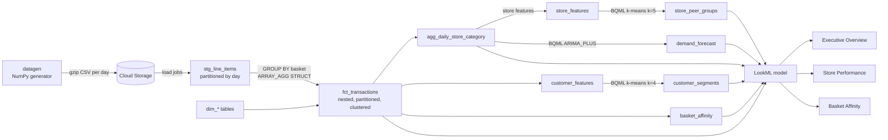

# Architecture

## Data flow

Everything below the load step is plain BigQuery SQL executed in a fixed order by `scripts/run_sql.py`; there is no orchestrator
dependency to stand up. Looker reads the resulting tables through the LookML model.

## Layers

| Layer | Objects | Responsibility |
|---|---|---|
| Ingest | `datagen/`, `scripts/load_data.py` | Reproducible, seeded data at 1M-50M transaction scale |
| Core | `fct_transactions`, `dim_*` | One nested copy of the truth, physically optimised for the filters people actually use |
| Marts | `agg_daily_store_category`, `customer_features`, `basket_affinity` | Pre-computation that would be too slow or costly at dashboard time |
| ML | BQML models and their output tables | Segmentation, peer grouping, forecasting inside the warehouse (no data egress) |
| Semantic | LookML views, explores, datagroups | Governed metrics, joins and caching |
| Presentation | 3 LookML dashboards | Executive, store-manager and merchandising views |

## Key design decisions

**Nested basket table instead of flat line items.** A basket is one row with an `ARRAY<STRUCT>` of lines. Basket-level questions
(sales, margin, traffic) read pre-computed rollup columns and never touch the array; line-level questions use
`LEFT JOIN UNNEST` through the `fct_transactions__line_items` view. This avoids a join between header and line tables, reads fewer rows,
and keeps one columnar copy of the data. Trade-off: line-level queries must UNNEST, and Looker needs a primary key on the header for
symmetric aggregates (set on `transaction_id`).

**Partition by day, cluster by `store_id, customer_id, channel_id`.** Every dashboard tile has a date filter; most also filter by store or
customer. Day partitioning gives deterministic pruning; clustering orders blocks within each partition so store and customer filters skip blocks.
Cluster column order follows filter selectivity in practice (store for operational views, customer for CRM lookups).

**Looker widens the partition predicate on purpose.** YoY needs the prior-year window, so a plain date filter would prune it away. The
transactions explore declares an `always_filter` on `current_period` and a `sql_always_where` covering
`[current_period_start - 1 year, current_period_end)`. BigQuery can prune on that predicate because it is constant-foldable, and the YoY measures
(`net_sales_current`, `net_sales_prior_year`) split the rows with a `period_bucket` CASE. Users never have to remember to widen a filter.

**Pre-aggregated cube for the hot path.** `agg_daily_store_category` is store x category x day. It is orders of magnitude smaller than the fact
table, feeds forecasting, and backs the store-vs-peers tile.

**BQML inside the warehouse.** k-means for customer segments (k=4) and store peer groups (k=5); `ARIMA_PLUS` with one model and one series per store x
category for 28-day demand. Segment *names* are assigned by ranking centroids on average spend rather than hard-coding centroid ids, because
k-means ids are arbitrary and change between trainings.

**Apriori-style pruning for affinity.** Counting all pairs in baskets of up to 30 lines is quadratic. The affinity query first computes item support,
keeps only frequent items, drops baskets left with fewer than two, and only then self-joins. Thresholds (`--min-item-support`,
`--min-pair-support`) scale with volume. Lift is paired with **average basket margin**, so a high-lift pair in tiny baskets does not outrank a
moderate-lift pair in valuable ones.

**Cache policy via datagroups.** `daily_load` triggers on the latest loaded date so dashboards recompute only when data moves; `weekly_ml` governs ML-derived
explores that change at most weekly.

## Synthetic data design

Real retail baskets are not independent draws, and affinity models need structure to find. The generator models:
- **Shopping missions** (weekly shop, breakfast, BBQ, family, pet owner, quick snack, wellness), each with a category mix and basket-size distribution.
  Customers have a preferred mission (65% of their trips), producing both co-purchase structure and behavioural segments.
- **Seasonality and growth**: weekday factors, a December peak, mild yearly cycle, and trend.
- **Store heterogeneity**: three formats with different traffic, per-store annual growth drift (so top and bottom YoY movers exist).
- **Customer lifecycle**: signup dates before and during the window, ~45% eventual churn, lognormal purchase propensity, 12% anonymous baskets.
- **Promotions**: a deterministic product-week promo calendar (15-30% off), so promo share of sales is reproducible.
- A unit test asserts the Bakery + Dairy lift is above 1.3, so the structure the models depend on cannot silently regress.

## Known limitations

- Weather, maps and external enrichment are intentionally out of scope; the model leaves room for them (add a view and a join).
- Peer grouping uses 5 behavioural features; it does not account for local demographics.
- ARIMA_PLUS is fit on 365 days and does not model promotions explicitly; promo-aware forecasting is a natural next step.
- The LookML and BQML have been validated statically (structure, references, SQL rendering) but not executed against a live Looker or BigQuery instance in this repository's CI.
